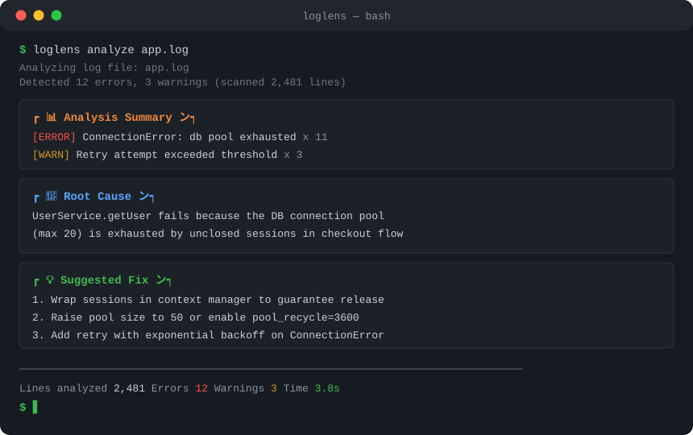

# LogLens 🔍

> AI-powered log analysis — find the root cause of production issues in seconds, not hours.

[](https://pypi.org/project/loglens/)
[](https://pypi.org/project/loglens/)
[](https://python.org)
[](LICENSE)
[](https://github.com/YaBoom/loglens-zyt/stargazers)



LogLens is an AI-powered log analyzer that reads your error logs, identifies the real root cause, and suggests concrete fixes — all from your terminal.

```bash
pip install loglens
loglens analyze app.log
```

## ✨ Features

- 🧠 **Root cause analysis** — LLM understands log context, not just patterns
- ⚡ **Fast triage** — extract key errors from massive logs in seconds
- 📊 **Structured reports** — summary → root cause → suggested fix
- 🔧 **Actionable fixes** — concrete remediation steps, not vague advice
- 🖥️ **CLI first** — lightweight, pipe-friendly, CI-friendly
- 🌐 **Web UI** — drag & drop log files for interactive analysis
- 🔌 **Configurable LLM** — DeepSeek by default, any OpenAI-compatible API works

## 📦 Installation

```bash
pip install loglens
```

Or from source:

```bash
git clone https://github.com/YaBoom/loglens-zyt.git
cd loglens-zyt
pip install -e .
```

## 🔑 API Key Setup

LogLens uses DeepSeek for root cause analysis:

```bash
# Option 1: command line
loglens analyze app.log -k sk-your-api-key

# Option 2: environment variable (recommended)
export DEEPSEEK_API_KEY=sk-your-api-key
loglens analyze app.log
```

Get an API key at the [DeepSeek platform](https://platform.deepseek.com/).

## 🚀 Quick Start

```bash
# Analyze a log file (LLM analysis)
loglens analyze /var/log/app.log -k sk-your-api-key

# Only look at the last 100 lines
loglens analyze /var/log/app.log --tail 100

# Filter by level (default: error)
loglens analyze /var/log/app.log --level warn

# Interactive mode
loglens shell -k sk-your-api-key

# Web UI at http://localhost:8080
loglens web
```

### Python API

```python
from loglens import LogAnalyzer

analyzer = LogAnalyzer()  # reads DEEPSEEK_API_KEY from env
report = analyzer.analyze("path/to/logfile.log")

print(report.summary)      # analysis summary
print(report.root_cause)   # root cause
print(report.suggestions)  # fix suggestions
```

## 🤝 Contributing

Issues and PRs are welcome!

## 📄 License

MIT License

---

<p align="center">Made with ❤️ by YaBoom · <a href="README.md">中文文档</a></p>
